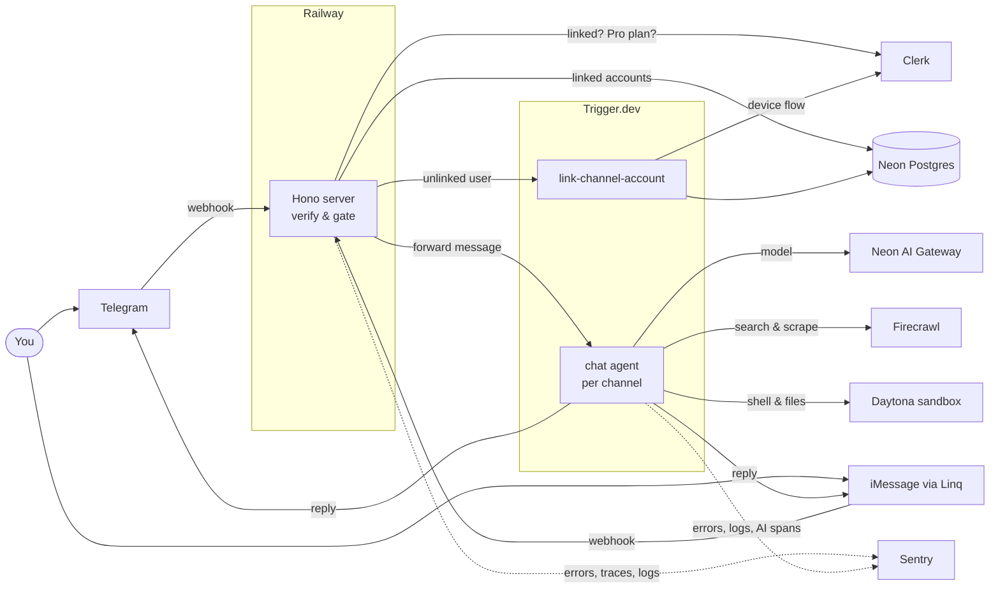

<div align="center">


# Personal AI Assistant

### The open source personal AI assistant you can text

Message it on Telegram or iMessage and it searches the web, works on a computer of its own and sends files back to you.

[](https://www.youtube.com/watch?v=5B1FGk3CMyg)

[](https://cwa.run/trigger-2)
[](https://cwa.run/greptile)
[](https://cwa.run/neon-1)
[](https://cwa.run/firecrawl)
[](https://cwa.run/clerk)
[](https://cwa.run/sentry)
[](https://cwa.run/railway)
<a href="https://railway.com/deploy/personal-ai-assist-1?referralCode=ANTONIO&utm_medium=integration&utm_source=template&utm_campaign=generic"></a>

</div>

An assistant works best when it lives where you already are. You text it the way you text a friend, and it texts back when the job is done.

This project is a working version of that idea. You chat with it over Telegram or iMessage, and behind each message is an agent with live web access and a Linux computer of its own. Sign in, a paid plan and error tracking are already set up, so you start from a working product and change whatever you like.

## Watch it being built

[](https://www.youtube.com/watch?v=5B1FGk3CMyg)

## Features

- Private chats on Telegram and iMessage, with the same agent behind both
- Live web search, page reading and structured data from marketplaces, travel sites and listings
- A Linux sandbox per user with a shell and files that stay between chats and platforms
- Send it a PDF, photo or document and it can send files and screenshots back
- The first message gets a sign in link, so every chat belongs to an account
- Only users on the Pro plan reach the agent, everyone else gets an upgrade link
- Each chat remembers the conversation without an extra database
- Long tasks run as background jobs with retries, up to 30 minutes per turn
- Errors, logs, traces and AI spans from the server and every agent run

## Built with

| Product                                      | What it does here                                                            |
| -------------------------------------------- | ---------------------------------------------------------------------------- |
| [**Trigger.dev**](https://cwa.run/trigger-2) | Runs the chat agent, the webhook endpoints it listens on and account linking |
| [**Greptile**](https://cwa.run/greptile)     | Reviews every change to the security critical code before it ships           |
| [**Neon**](https://cwa.run/neon-1)           | Serverless Postgres for linked accounts and the AI Gateway the model runs on |
| [**Firecrawl**](https://cwa.run/firecrawl)   | Web search, page scraping and structured data sources for the agent          |
| [**Clerk**](https://cwa.run/clerk)           | Sign in through an OAuth device flow and Billing for the Pro plan            |
| [**Sentry**](https://cwa.run/sentry)         | Errors, logs, traces and AI monitoring from the server and every task run    |
| [**Railway**](https://cwa.run/railway)       | Hosts the Hono server that receives the Telegram and iMessage webhooks       |
| [**Daytona**](https://cwa.run/daytona)       | One cloud sandbox per user with a shell and files                            |

Also uses Hono, AI SDK 7, Drizzle ORM, the Telegram Bot API and [Linq](https://linqapp.com) for iMessage.

## How it works



Every message lands on the Hono server first (`src/telegram-webhook.ts`, `src/linq-webhook.ts`). It checks the secret or signature of the platform, ignores group chats and passes the sender through the channel gate (`src/channel-gate.ts`).

The gate decides who reaches the agent. An unknown sender starts the `link-channel-account` task (`src/trigger/link-account.ts`), which texts them a Clerk sign in link and saves the account once they approve it. A linked user without the Pro plan gets an upgrade link (`src/billing.ts`). Everyone else is forwarded to the Trigger.dev endpoint of their channel.

Each turn (`src/trigger/channel-agent.ts`) streams a reply with the web tools (`src/trigger/web-tools.ts`) and the computer tools (`src/trigger/computer-tools.ts`) and stops after 40 steps. The sandbox is named after the user, so the same files are there on both platforms.

## Getting started

You need Node.js 20.12+ and an account with [Clerk](https://cwa.run/clerk), [Neon](https://cwa.run/neon-1), [Trigger.dev](https://cwa.run/trigger-2), [Daytona](https://cwa.run/daytona) and [Firecrawl](https://cwa.run/firecrawl), plus a Telegram bot from [@BotFather](https://t.me/BotFather). [Linq](https://linqapp.com) (for iMessage) and [Sentry](https://cwa.run/sentry) are optional.

**1. Clone and install**

```bash
git clone https://github.com/code-with-antonio/ai-personal-assistant.git
cd ai-personal-assistant
npm install
```

**2. Create `.env`**

```bash
# Clerk: API keys
CLERK_PUBLISHABLE_KEY=
CLERK_SECRET_KEY=

# Clerk: a confidential OAuth app with the Device Authorization Grant enabled
CLERK_OAUTH_ISSUER=
CLERK_OAUTH_CLIENT_ID=
CLERK_OAUTH_CLIENT_SECRET=

# Neon: pooled string for the app, direct string for drizzle-kit
DATABASE_URL=
DATABASE_URL_UNPOOLED=

# Neon AI Gateway
NEON_AI_GATEWAY_BASE_URL=
NEON_AI_GATEWAY_TOKEN=

# Trigger.dev: the development key and the project ref
TRIGGER_SECRET_KEY=
TRIGGER_PROJECT_REF=

# Telegram: the bot token, and a secret you choose for Telegram -> server
TELEGRAM_BOT_TOKEN=
TELEGRAM_WEBHOOK_SECRET=

# Trigger.dev webhook endpoints: URL and generated secret of the
# `telegram` and `linq` endpoints, shown in the Trigger.dev dashboard
TRIGGER_TELEGRAM_WEBHOOK_URL=
TRIGGER_TELEGRAM_WEBHOOK_SECRET=
TRIGGER_LINQ_WEBHOOK_URL=
TRIGGER_LINQ_WEBHOOK_SECRET=

# Linq (iMessage): optional
LINQ_API_V3_API_KEY=
LINQ_WEBHOOK_SECRET=

# Daytona and Firecrawl
DAYTONA_API_KEY=
FIRECRAWL_API_KEY=

# Sentry: optional. Without a DSN nothing is reported. The other three
# upload the task source maps on deploy
SENTRY_DSN=
TRIGGER_SENTRY_DSN=
SENTRY_ORG=
SENTRY_PROJECT=
SENTRY_AUTH_TOKEN=
```

**3. Set up billing**

In Clerk, enable Billing and create a user plan slugged `pro`.

**4. Push the schema and run**

```bash
npm run db:push            # create the tables
npm run dev                # terminal 1: Hono server on http://localhost:3000
npx trigger.dev@4.8.3 dev  # terminal 2: Trigger.dev tasks
```

**5. Point Telegram at the server**

Telegram needs a public URL, so expose port 3000 with a tunnel like ngrok or cloudflared and register it:

```bash
curl "https://api.telegram.org/bot$TELEGRAM_BOT_TOKEN/setWebhook" \
  -d "url=https://<your-tunnel>/telegram/webhook" \
  -d "secret_token=$TELEGRAM_WEBHOOK_SECRET"
```

For iMessage, set `https://<your-tunnel>/linq/webhook` as the `message.received` webhook in Linq.

Send your bot a message, open the sign in link, subscribe to Pro and start chatting.

## Deployment

The tasks run on Trigger.dev and the server runs on Railway. Deploy the tasks first, because the server needs the URLs of their webhook endpoints.

**1. Deploy the tasks to Trigger.dev**

```bash
npx trigger.dev@4.8.3 deploy
```

**2. Give the tasks their variables**

Add these to the production environment of your project in Trigger.dev:

```bash
DATABASE_URL=
CLERK_OAUTH_ISSUER=
CLERK_OAUTH_CLIENT_ID=
CLERK_OAUTH_CLIENT_SECRET=
NEON_AI_GATEWAY_BASE_URL=
NEON_AI_GATEWAY_TOKEN=
TELEGRAM_BOT_TOKEN=
DAYTONA_API_KEY=
FIRECRAWL_API_KEY=

# Optional, only if you use iMessage or Sentry
LINQ_API_V3_API_KEY=
TRIGGER_SENTRY_DSN=
```

**3. Deploy the server to [Railway](https://cwa.run/railway)**

[](https://railway.com/deploy/personal-ai-assist-1?referralCode=ANTONIO&utm_medium=integration&utm_source=template&utm_campaign=generic)

Fill in the variables it asks for. Use your Trigger.dev **production** secret key for `TRIGGER_SECRET_KEY`, and take the `TRIGGER_*_WEBHOOK_*` values from the production `telegram` and `linq` endpoints in Trigger.dev.

**4. Register the production webhooks**

Run the `setWebhook` call from Getting started again with your Railway domain, and update the webhook URL in Linq.

## Contributing

Issues and pull requests are welcome. Run `npm run build` before opening one. Changes to webhooks, access gating, account linking, agent tools or secrets get a [Greptile](https://cwa.run/greptile) review first. `AGENTS.md` lists the files that count.

<div align="center">

Built by [Code With Antonio](https://www.codewithantonio.com)

</div>
